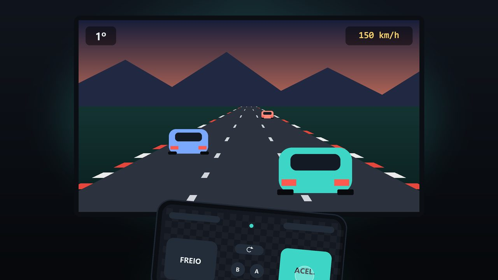

# Joyfone

### Seu celular vira controle do PC.

Controle de jogo completo na tela para jogar no PC. 
Tudo por **Bluetooth**, **sem internet**, **sem conta** e **sem anúncios**.

**[Abrir o site](https://leotiziu.github.io/joyfone.github.io/)** · **[Baixar o beta](https://github.com/LeoTiziu/joyfone.github.io/releases/latest)** · **[Como conectar](https://leotiziu.github.io/joyfone.github.io/como-conectar.html)** · **[English](https://leotiziu.github.io/joyfone.github.io/en/)**

---

## 🎮 Por que o Joyfone?

Esqueceu o controle? Quer chamar mais alguém para jogar?
**O celular que já está no seu bolso resolve.**

| | |
|---|---|
| 🖥️ **Jogue no PC** | O receptor gratuito faz o Windows ver o celular como um controle **Xbox 360** ou **DualShock 4**. Funciona nos jogos que aceitam esses controles. |
| 🔒 **Sem espionagem** | Sem conta, sem anúncios e sem telemetria. O app nem pede permissão de internet. |

## ✨ Recursos

- **Controle completo:** dois analógicos, direcional, gatilhos analógicos e todos os botões, com multitoque.
- **Modo Corrida:** incline o celular como um volante; gatilhos grandes para acelerar e frear.
- **Modo Arma:** mire movendo o celular (giroscópio). Um tranco rápido recarrega, e o celular vibra a cada tiro.
- **Até 4 jogadores** no mesmo PC, cada celular como um controle.
- **Editor de layout:** arraste e redimensione cada botão, com grade e desfazer.
- **12 capas originais** ou uma foto sua como fundo.
- **4 idiomas:** Português, English, 中文 e Русский.
- **Segurança na queda:** se a conexão cair, todos os botões são soltos na hora.

## 🚀 Comece em 3 passos

1. **Baixe** o [`Joyfone_app.apk`](https://github.com/LeoTiziu/joyfone.github.io/releases/latest/download/Joyfone_app.apk) no celular Android (9 ou mais novo).
2. **No PC:** baixe o [receptor para Windows](https://github.com/LeoTiziu/joyfone.github.io/releases/latest/download/Joyfone-Receptor-win-x64.zip), instale o driver gratuito [ViGEmBus](https://github.com/nefarius/ViGEmBus/releases) e pareie o celular com o PC.
3. **Jogue.** O passo a passo completo está em [Como conectar](https://leotiziu.github.io/joyfone.github.io/como-conectar.html).

## 🕹️ Experimente no site

O site tem **três minijogos** que você joga com o controle desenhado, com o teclado ou com um controle de verdade, inclusive o próprio Joyfone:

**🚀 Nave**: destrua pedras, melhore a arma e enfrente o chefão. · **🐍 Cobrinha**: o clássico. · **🦖 Caverna**: pule obstáculos, pegue lanças e flechas e enfrente dinossauros.

Entre no **ranking** e, se quiser, na **Comunidade Joyfone**. Também tem um [testador de controle](https://leotiziu.github.io/joyfone.github.io/testador.html) para ver botões e analógicos ao vivo.

**[▶ Jogar agora](https://leotiziu.github.io/joyfone.github.io/)**

## 💚 Apoie

O Joyfone é feito por um desenvolvedor independente. Um cafezinho pelo Pix, a partir de **R$ 2**, mantém o app sem anúncios.
**[Apoiar o Joyfone](https://leotiziu.github.io/joyfone.github.io/#apoiar)**

Gostou? **Deixe uma ⭐ neste repositório** e mande para quem vive procurando o controle.

## 📌 Status

O Joyfone está em **beta (0.5.2)**. O modo TV está desativado por enquanto, até a conexão com TVs ser corrigida. Jogos com anti-cheat podem bloquear controles virtuais no PC.

Achou um problema ou tem uma ideia? **[Abra uma issue](https://github.com/LeoTiziu/joyfone.github.io/issues)**.

---

Este repositório contém só o site (HTML, CSS e JavaScript estáticos, em português e inglês). O código do app não é público. 
© 2026 Leonardo Pereira. Todos os direitos reservados. 
“Xbox”, “PlayStation” e “DualShock” são marcas de seus titulares, citadas só para indicar compatibilidade. O Joyfone não é afiliado, patrocinado nem aprovado por eles.

